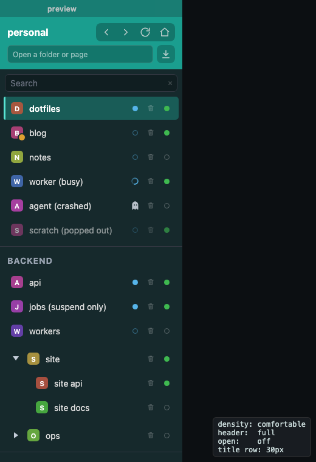

# chrome-core


[](LICENSE)

The sidebar four macOS apps share — [warden](https://github.com/lockyc/warden) (terminals),
[curator](https://github.com/lockyc/curator) (browser tabs), [lector](https://github.com/lockyc/lector)
(local doc sites) and [flotilla](https://github.com/lockyc/flotilla) (document workspaces) — as one
framework-free CSS and vanilla-JS component, `ChromeSidebar`, embedded through a thin Rust crate.
It is the view and the self-update every app needs; each app's content area and backend stay its
own.



## Use

Take chrome-core as a **build-dependency** pinned by `rev`:

```toml
[build-dependencies]
chrome-core = { git = "https://github.com/lockyc/chrome-core", rev = "<commit>" }
```

and write its assets into the app's `frontendDist` from `build.rs`, before Tauri embeds it (the
generated files are git-ignored; `cargo build` regenerates them):

```rust
std::fs::write("../src/chrome-core.css", chrome_core::SIDEBAR_CSS)?;
std::fs::write("../src/chrome-core.js",  chrome_core::SIDEBAR_JS)?;
```

Then mount it with the app's callbacks and config, and push each change of tabs with `update`:

```js
const sidebar = ChromeSidebar.mount(document.getElementById("sidebar"), {
  onSelect: (id) => invoke("select_tab", { id }),
  onUnload: (id) => invoke("unload_tab", { id }),
  onResize: (width) => invoke("save_sidebar_width", { width }),
}, { autoUpdate: true });

sidebar.update(tabsDto);
```

The full contract — the tab DTO, every callback and config key — is in [docs/contract.md](docs/contract.md).

## What it provides

- **The banner** — the window's name and accent colour, optional back / forward / reload / home,
  a link field and a downloads button.
- **Tab rows** — a letter tile or icon, a title, status dots (needs attention, session present,
  loaded), and optional unload-group and remove controls; groups headed by their own row,
  collapsible project trees with a rescan button, pinned "Open" and "Background" sections.
- **Around the rows** — an always-on search field, the end-session confirmation (⏻ suspend /
  ☠ destroy), a right-click hook, pop-out and pop-in from the tile, and the error bar.
- **Sizing** — comfortable and compact density, and the sidebar's resize drag.
- **Self-update** — the update check, the update bar, install and relaunch, and the periodic
  re-check.

## Status

In use by all four apps, each pinned to a commit rev; there are no tags or releases.

## Related

[config-core](https://github.com/lockyc/config-core) (config primitives) and
[shell-core](https://github.com/lockyc/shell-core) (app shell and release tooling) are the other
two cores the apps share.

## Development

```sh
git clone https://github.com/lockyc/chrome-core && cd chrome-core
cargo build     # compiles the include_str! constants (catches missing/renamed assets)
node --test     # unit-tests the component's pure logic (zero deps)
just dev        # serve preview.html, the component with sample tabs and no app
```

`docs/screenshots/sidebar.png` is `plate render --png docs/screenshots/sidebar.png --size 520x760
preview.html`. Conventions: [CLAUDE.md](CLAUDE.md).

## License

MIT — see [LICENSE](LICENSE).
